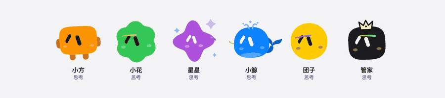
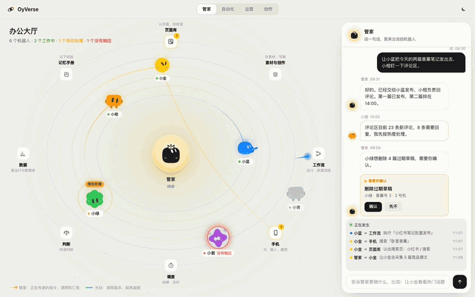
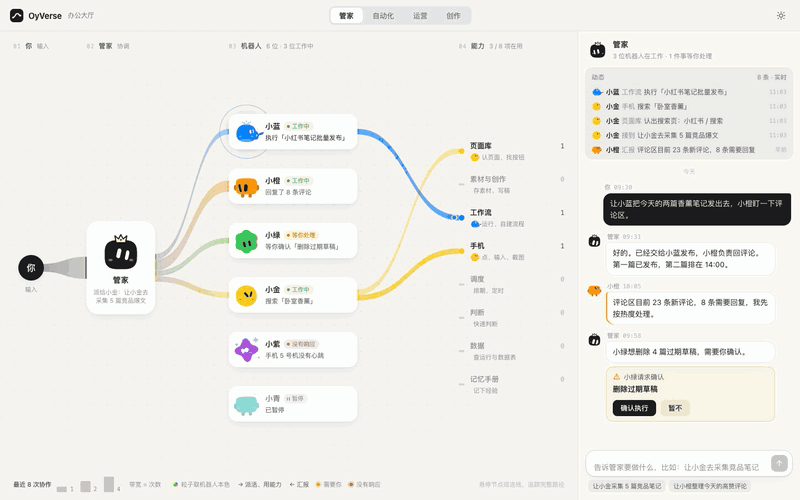
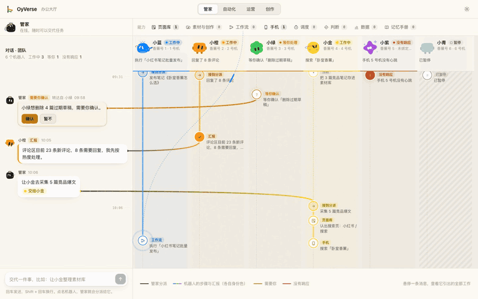
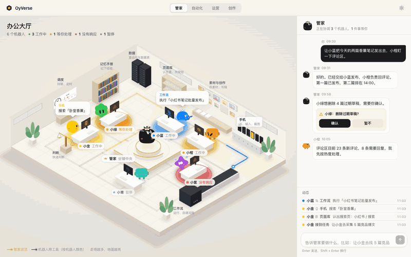
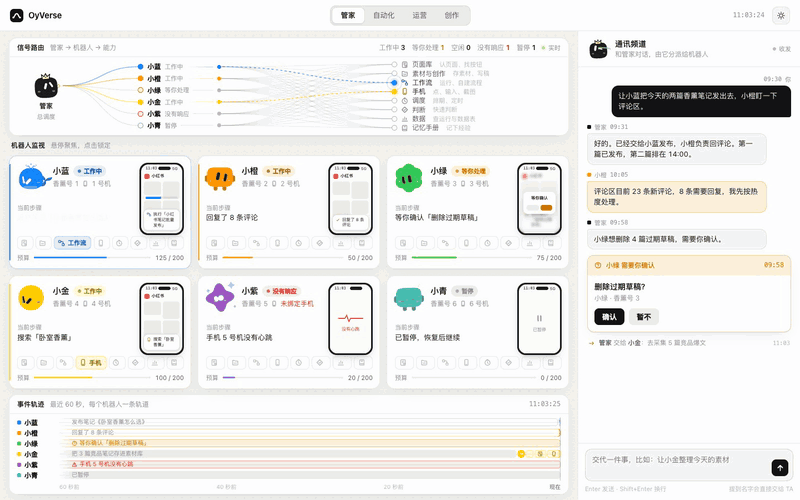

# OyVerse

**简体中文** · [English](README.en.md)

让 AI Agent 在任何可视化场景里**有形象、有状态、能看见它们怎么协作**。

- **角色**：6 个扁平角色（含协调者“管家”），每个有身份色和 9 种状态表情，纯 SVG、零依赖。
- **场景**：5 种完全不同的可视化——星系、指挥中心、等距办公室、神经流、对话河流。
- **协议**：一份很小的事件协议（`delegate` / `use` / `report` / `ask` / `error` / `state`）。把你自己的 Agent 系统接到这条事件流上，所有场景都能直接用。

不需要 npm、不需要构建，双击 HTML 就能打开。

| 打开 | 是什么 |
|---|---|
| [`characters/index.html`](characters/index.html) | 角色 × 状态 图鉴 |
| [`scenes/index.html`](scenes/index.html) | 五个场景的选择页（每个都可交互） |



| 星系 | 神经流 |
|---|---|
|  |  |
| **对话河流** | **等距办公室** |
|  |  |
| **指挥中心** | |
|  | |

## 目录

```text
registry.js   角色与场景的唯一清单：选择页、图鉴和录屏都读它
characters/   角色：oy-character.js（表情引擎 + 角色外形 + 状态 API）、图鉴页、录屏用的舞台页
core/         协议：agent-stream.js（事件流）、demo-team.js（示例团队与事件脚本）
scenes/       场景：每个场景一个独立 HTML，只读事件流
docs/         协议、角色、场景说明，以及给 AI 用的接入提示词
media/        README 里的 GIF（由 npm run record 生成）
tools/        record.mjs：用无头浏览器 + ffmpeg 录制 GIF
AGENTS.md     给 AI 编码助手看的仓库说明
```

## 三步用起来

1. **只要一个角色**：

   ```html
   <div id="me"></div>
   <script src="characters/oy-character.js"></script>
   <script>
     const bot = OyCharacter.create(document.getElementById('me'), { character: 'deepseek', color: 3, state: 'working', size: 96 });
     bot.setState('waiting');   // working waiting idle error paused thinking happy done busy
   </script>
   ```

2. **看场景**：打开 `scenes/` 下任意一个 HTML。它们用 `core/demo-team.js` 的示例团队循环播放事件，在右侧输入框里说一句话会触发一次派活。

3. **接自己的 Agent**：按 [docs/protocol.md](docs/protocol.md) 把你的 Agent、能力和事件翻译成协议里的形状，`stream.emit(...)` 即可。

## 新增角色或场景

1. 角色：在 `characters/oy-character.js` 里加外形（见 [docs/characters.md](docs/characters.md)）；场景：在 `scenes/` 加一个 HTML（见 [docs/scenes.md](docs/scenes.md)）。
2. 在 [`registry.js`](registry.js) 里加一行。选择页和图鉴会自动出现它。
3. 录 GIF：`npm install`（只装一个开发依赖 playwright-core），然后 `npm run record -- --only=<id>`。需要本机有 Chrome 和 ffmpeg。不带参数会重录全部，`--only=lineup` 只录角色合影。

## 用 AI 接入

把 [AGENTS.md](AGENTS.md) 和 [docs/prompts.md](docs/prompts.md) 交给你的 AI 编码助手（Claude、Cursor、Copilot……）。`prompts.md` 里有现成的提示词：接入 LangGraph / CrewAI / OpenAI Agents、嵌进 React / Vue、新增场景、新增角色外形。

## 文档

- [事件协议](docs/protocol.md)
- [角色](docs/characters.md)
- [场景](docs/scenes.md)
- [接入提示词](docs/prompts.md)

## 致谢与许可

- 表情与眼睛动画来自 **[Grok Ball](https://github.com/tycoding/grok-ball)**（作者 tycoding，MIT 协议，纯 SVG、零运行依赖）。OyVerse 在它之上加了角色外形、饰物、状态映射和场景。详见 [THIRD_PARTY_NOTICES.md](THIRD_PARTY_NOTICES.md)。
- Grok Ball 与 xAI / Grok 无关。
- OyVerse 以 [MIT](LICENSE) 协议开源。
